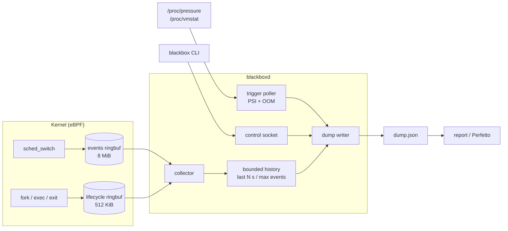

<div align="center">

# Blackbox

**A flight recorder for the Linux scheduler.**

Always on. Low overhead. When your machine stalls, the trace of what happened
is already on disk.

[](https://github.com/Srujan-rai/Blackbox/actions/workflows/ci.yml)
[](https://github.com/Srujan-rai/Blackbox/releases)
[](LICENSE)


[Website](https://srujan-rai.github.io/Blackbox/) ·
[Quick start](#quick-start) ·
[How it works](#how-it-works) ·
[Docs](#documentation) ·
[Releases](https://github.com/Srujan-rai/Blackbox/releases)

</div>

---

When a box freezes, the interesting part is the half-second *before* anyone
noticed: which tasks were runnable but could not get a CPU, who was holding
it, what was stuck on I/O. By the time you attach `perf`, that moment is gone.

Blackbox keeps a rolling window of every context switch using eBPF and writes
a self-describing trace the instant CPU, memory or I/O pressure crosses a
threshold, the OOM killer fires, or you ask for one. Read it as a plain-text
report, or open it in [Perfetto](https://ui.perfetto.dev/).

```console
$ sudo blackbox start
$ blackbox dump -o incident.json && blackbox report incident.json

top cpu consumers
-----------------
  cpu busy 65.3%, idle 34.7% of observed cpu time

    5.97%     392.0ms  pid 2604087  bpf-collector
    5.68%     373.3ms  pid 2591860  brave
    3.37%     221.4ms  pid 2604305  xargs

longest scheduler delays
------------------------
  time a runnable task spent waiting for a cpu

       7.3ms  pid 2604340  sh
       5.1ms  pid 2604337  sh
       5.1ms  pid 2604353  xargs

most blocked time
-----------------
     818.1ms  pid 2471680  kworker/1:0
     816.0ms  pid 15       rcu_preempt
```

<sub>Real output from <a href="scripts/demo.sh"><code>scripts/demo.sh</code></a> on kernel 7.0, trimmed. <code>bpf-collector</code> is Blackbox measuring itself.</sub>

## Highlights

- **Always recording.** A bounded window of the last *N* seconds of
  `sched_switch` and fork/exec/exit events, with memory capped at 64 B per
  event.
- **Dumps itself when it matters.** PSI triggers for CPU, memory and I/O with
  hysteresis (no dump storms), an OOM-kill trigger, or `blackbox dump` on
  demand.
- **Answers the real question.** Separates *scheduler latency* (runnable but
  waiting for a CPU) from *blocked time* (sleeping or waiting on I/O), and
  ranks who was eating the CPU.
- **Opens in Perfetto.** `blackbox report --perfetto` emits Chrome JSON that
  loads directly in [ui.perfetto.dev](https://ui.perfetto.dev/), with
  per-task tracks and lifecycle markers.
- **Honest about gaps.** Every dump records its own evictions and kernel-side
  ring-buffer drops, so a lossy trace says so instead of looking complete.
- **Degrades, never dies.** No BTF, no privileges, no object? The daemon keeps
  serving status and trigger dumps, and `blackbox status` tells you why
  collection is off.
- **Small and safe by design.** One tracepoint on the hot path, no kprobes, no
  network, CO-RE so one object runs across kernels.

## Quick start

**Requirements:** Linux 5.15+ with BTF (`/sys/kernel/btf/vmlinux`), and root
or `CAP_BPF` + `CAP_PERFMON` to load the BPF program.

### Install a release

Download the tarball for your architecture from
[Releases](https://github.com/Srujan-rai/Blackbox/releases) and check it
against the attached `.sha256`:

```sh
tar -xzf blackbox-<version>-x86_64-unknown-linux-gnu.tar.gz
cd blackbox-<version>-x86_64-unknown-linux-gnu
sudo install -m755 blackbox blackboxd /usr/local/bin/
sudo install -d /usr/local/lib/blackbox /etc/blackbox
sudo install -m644 blackbox-bpf.o /usr/local/lib/blackbox/
sudo install -m644 examples/config.toml /etc/blackbox/config.toml
```

<details>
<summary><b>Build from source</b></summary>

You need stable Rust, plus nightly with `rust-src` and a static
[`bpf-linker`](https://github.com/aya-rs/bpf-linker) for the BPF crate.

```sh
./crates/bpf/build.sh release   # BPF object -> ./blackbox-bpf.o
cargo build --release           # CLI and daemon -> target/release/
```

The non-obvious BPF build flags are explained in
[`crates/bpf/BUILD_NOTES.md`](crates/bpf/BUILD_NOTES.md).

</details>

### Use it

```sh
sudo blackbox start                 # start the daemon (--foreground to stay attached)
blackbox status                     # is it collecting? drops? last trigger?

sudo blackbox dump -o incident.json # take a trace right now
blackbox report incident.json       # read it as text
blackbox report incident.json --perfetto > incident.perfetto.json
                                    # ...or drag this onto ui.perfetto.dev

sudo blackbox stop                  # clean shutdown
```

Triggered dumps land in `/var/lib/blackbox/dumps/` on their own. They are
owner-only (`0600`), so read them with `sudo blackbox report ...`.

### Run it as a service

```sh
sudo install -m644 contrib/blackboxd.service /etc/systemd/system/
sudo systemctl daemon-reload && sudo systemctl enable --now blackboxd
```

The unit uses `RuntimeDirectory=blackbox`, `Restart=on-failure` and a
conservative sandbox (`NoNewPrivileges`, `ProtectSystem`, `ProtectHome`).

## Commands

| Command | What it does |
|---|---|
| `blackbox start [--config PATH] [--foreground]` | Start the daemon (detached by default) |
| `blackbox status` | Health, collection state, window counters, kernel drops, last trigger |
| `blackbox dump [-o FILE]` | Write a trace now, to the dump directory or `FILE` |
| `blackbox report FILE [--perfetto] [--top N] [--per-cpu]` | Text report, or Perfetto JSON |
| `blackbox stop` | Shut down cleanly: workers joined, socket and PID file removed |

`blackboxd` itself takes `--config PATH` and `--no-bpf` (status and triggers
only, handy for development).

## Configuration

Defaults work out of the box. The settings you are most likely to touch:

```toml
[history]
max_events  = 250000    # window size; ~16 MB. Raise it on busy hosts
max_seconds = 30

[pressure]
memory = { enabled = true, threshold_pct = 20.0, consecutive = 4 }

[dump]
keep_last = 10          # retention

[bpf]
# filter_pids = [1234]  # trace only these pids to cut overhead
```

See [docs/configuration.md](docs/configuration.md) for every option.

## How it works



Two decisions shape everything else:

1. **The ring buffer is transport, not storage.** A BPF ring buffer cannot
   hold history, so the "last *N* seconds" lives in userspace and is refilled
   continuously. The honest consequence: history exists only while
   `blackboxd` is running.
2. **All the hard logic is plain, testable Rust.** The BPF side only stamps a
   CPU id and copies fixed 64-byte records. Interval reconstruction, latency
   classification, PSI hysteresis and reporting live in `blackbox-core`,
   which runs without privileges.

On-CPU time is rebuilt per CPU from consecutive switches. The outgoing task's
`prev_state` says why it left: preempted or yielded means it was still
runnable (**scheduler latency**); anything else means it **blocked**. The
idle task is counted as idle, not as a consumer.

More in [docs/architecture.md](docs/architecture.md).

## Overhead

Blackbox reads every context switch, so its cost follows the machine-wide
switch rate, not CPU load.

| Scenario (8-core host) | Cost |
|---|---|
| Compute-bound workload | essentially none |
| Switch-heavy workload (400k switches/run) | ~0.6 to 1.7 µs per switch; daemon ~0.6 of one core |
| Same, with a PID filter | daemon ~0.15% of one core; workload +1.5 to 4.7% |
| Memory | ~55 MB RSS with BPF attached; history capped at `max_events x 64 B` |

Method, raw numbers and reproduction steps: [docs/overhead.md](docs/overhead.md).

## Limitations

- **History only while running.** A stall that kills `blackboxd` leaves a
  short or empty window.
- **Busy hosts shorten the window.** At ~500k switches/s the default 250k
  events cover ~0.5 s. Raise `max_events` or use a PID filter.
- **15-character names.** You get the kernel `comm` and a truncated exec path,
  not full command lines.
- **Needs BTF** (`CONFIG_DEBUG_INFO_BTF`).
- **Not yet:** block I/O latency events, cgroup scoping, on-disk history
  across restarts.

## Documentation

| Doc | Covers |
|---|---|
| [Configuration](docs/configuration.md) | Every option, triggers, window sizing, PID filter, dump files |
| [Architecture](docs/architecture.md) | Threads, failure posture, interval reconstruction, wire formats |
| [Dump format](docs/dump-format.md) | Schema fields, `prev_state` meanings, completeness counters |
| [Operations](docs/operations.md) | Running it for real, troubleshooting |
| [Security](docs/security.md) | Privileges, what is recorded, socket access, dumps at rest |
| [Overhead](docs/overhead.md) | Benchmark method and results |
| [BPF build notes](crates/bpf/BUILD_NOTES.md) | Why the BPF build flags are what they are |

## Development

```sh
cargo test --workspace                                 # no privileges needed
cargo clippy --workspace --all-targets -- -D warnings
cargo fmt --all -- --check

sudo scripts/demo.sh    # end to end on a real kernel: start, load, dump, report
sudo scripts/bench.sh   # overhead benchmark
```

```text
crates/core     pure analysis: history, reconstruction, PSI/OOM, dumps, reports
crates/daemon   blackboxd: BPF loader, collector, trigger poller, control socket
crates/cli      blackbox: start / status / dump / stop / report
crates/bpf      the tracepoint programs (own toolchain, outside the workspace)
crates/bench    dependency-free workload for the benchmark
```

CI runs fmt, clippy, tests and a BPF build on every push and pull request.
Tagged releases publish binaries, the BPF object and checksums.

## License

The userspace crates are [MIT](LICENSE).

The BPF object is dual **MIT/GPL**: reading the tracepoint context needs
`bpf_probe_read`, a GPL-only kernel helper, so the kernel requires a
GPL-compatible licence declaration. The source stays available under MIT, and
the userspace daemon is not affected because the BPF object is a separate
program, not linked into it.
